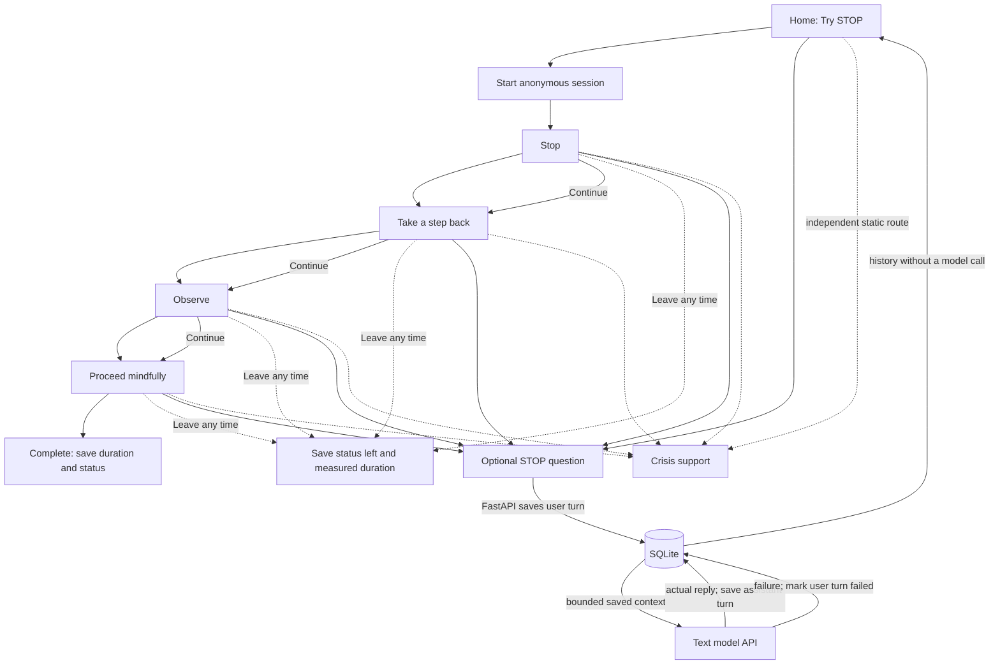

# Part 3.2 — Working vertical slice

## Scope

This increment implements one skill: STOP. It demonstrates the app boundary,
optional model explanation, local conversation/session persistence, an elapsed
duration, an independent crisis-support route, an explicit early exit, and a
sanitized model-failure state. It is a local coursework prototype for fictional
scenarios. It is not therapy, diagnosis, emergency support, or a monitored
service.

The live text provider call is optional and can be disabled. The current key is
read only by FastAPI from the ignored `backend/.env`; it is never sent to Vue.
The deterministic demo mode and forced-failure mode run without contacting a
provider. Voice/WebRTC is a separate earlier class increment and is not part of
the STOP text/session persistence path.

## Main experience

The actual experience has a sequential four-step Continue control. Users can
leave from any step and can open crisis support at any time. It does not
currently implement skip or pause controls, despite those controls in the Part
3.1 design proposal. The exercise is not forced to run on the proposed
5/10/30/15-second pace; the displayed duration measures real elapsed time from
session start through completion or leave.

## Model role and data

The model is an optional explainer for the reviewed STOP skill. FastAPI selects
the model, prompt, and recent conversation context (at most eight saved turns),
sets the provider request, validates the response, and handles errors. It does
not diagnose, judge distress, determine whether support appears, or operate
SQLite. The browser sends only a question and session identifier to the app API.

SQLite at `data/app.sqlite3` stores:

- `conversations`: opaque conversation identifier and creation timestamp.
- `skill_sessions`: linked conversation, STOP skill, current step, status, start
  and end timestamps, and measured duration in seconds.
- `messages`: linked conversation/session, role, content, request status, model
  source for actual assistant replies, and timestamp.

No user name, email, or account identifier is requested. A failed request keeps
the submitted user message marked `failed` and saves no assistant message. The
crisis information is static and available even when the model is not. Ordinary
history reads SQLite and makes no provider call. The database stays local and
is Git-ignored.

## R/D connections

The Part 3.1 report in `docs/report.md` connects the supplied findings to design.
R1 reports attention loss beyond 90–100 seconds; this slice keeps one short,
optional-input skill and does not put model conversation inside the fixed step
sequence. D1 does not establish a reliable distress-detection method; therefore
support is user-opened and never gated on model inference or a distress
classifier. Full wording for R2–R4 and D2–D6 was not included in the supplied
assignment excerpt, so no claims are attributed to those findings.

## Endpoints and failure behavior

| Route | Purpose | Failure handling |
| --- | --- | --- |
| `POST /api/exercises` | Create conversation and in-progress STOP session | UI shows start error; no successful session is implied |
| `PATCH /api/exercises/{id}/step` | Save the next sequential step | UI retains the step and offers retry/leave |
| `POST /api/exercises/{id}/messages` | Persist user turn, request optional explanation, persist only a valid real reply | Sanitized error; user turn remains failed; no fabricated reply |
| `POST /api/exercises/{id}/finish` | Mark completed or left with end time and duration | UI reports if local database confirmation failed; page-exit beacon is a best-effort fallback |
| `GET /api/history` | Return recent sessions and messages from SQLite | History gets an unavailable notice; current exercise can continue |
| `GET /api/support` | Return static crisis-support wording | The visible support page is local/static and does not wait for model generation |

Live text calls use a finite timeout and the backend returns bounded, sanitized
failure detail. The app provides `MODEL_MODE=openai`, `MODEL_MODE=demo`, and
`MODEL_MODE=fail` for live, deterministic, and failure verification. Treat
provider handling according to the configured account’s terms; local storage
does not imply provider-side non-retention.

## Personalization, control, and open questions

The current version personalizes only through explicit session step progression
and optional question context. It does not infer a preference or emotional
state. The person chooses whether to ask the model, controls progression, can
leave, and can open the support route. No editable personalization controls
have been implemented yet.

Open decisions from the design proposal remain: finalized step wording and
pace; crisis-resource localization; message/session retention and deletion;
editable text-size, reduced-motion, and timing preferences; whether saved chat
context should be opt-in; optional self-report; privacy consent and hosting; and
whether/how to implement the proposed RAG workflow. See `docs/report.md` for
the complete questions. Part 3.2 is a small working slice, not completion of
those product decisions.
