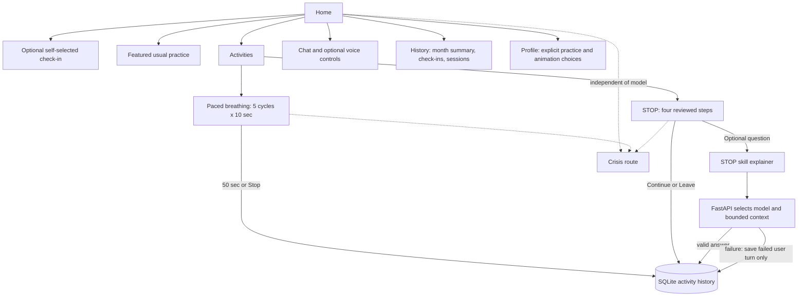

# Part 3.2 — Working application and design notes

## Scope

This local coursework prototype includes a five-cycle paced-breathing practice (50 seconds), the four-step STOP practice, optional coarse self-reported check-ins, a monthly activity summary, editable local preferences, text and optional voice entry points, local history, and persistent crisis support. It is for fictional scenarios; it is not therapy, diagnosis, medical advice, crisis monitoring, or emergency support.

The video-inspired navigation has Home, Activities, Chat, History, Profile, and Crisis views. Home offers a skippable three-choice check-in, the explicitly selected usual practice, and section links. Paced breathing uses five 4-second inhale / 6-second exhale cycles, an optional expanding visual cue, and a Stop control. STOP remains a sequential four-step practice. Leaving either practice records `left` with the server-measured duration. A crisis control remains visible throughout.

History combines breathing and STOP sessions, a month count/total, check-ins, and saved STOP conversations. Check-ins are explicit user self-reports, are not used to change the model or recommend an activity, and can be removed. Profile stores the usual practice and breathing animation choice in SQLite. Chat questions are limited to explanations of the reviewed STOP skill, from a saved STOP practice. Voice is separate, starts only on user action, and is not saved by this app.

The profile does not reproduce the reference video's symptom screening questionnaire or score. No validated instrument or scoring specification was provided for this project, so the app does not assess symptoms, infer safety, or diagnose.

## Main experience

Practices can be stopped or left. A page-exit beacon is best-effort; if the client closes abruptly or the local server is unavailable, saving an exit is not guaranteed. STOP model requests are optional and included in measured session duration. The 50-second breathing timer is measured from the persisted session start. No pause control excludes time from measurement.

## Model role and data

The model is an optional explainer for the reviewed STOP skill. FastAPI selects the model, prompt, and at most eight recent successful messages, validates the provider response, and handles failures. It does not diagnose, infer mood, decide when support appears, or access SQLite. The browser sends a question and session identifier to the app API. A failed call leaves a failed user turn and stores no fabricated answer. Voice uses a separate explicit WebRTC call and is not part of saved text conversations.

SQLite at `data/app.sqlite3` stores:

- `conversations`: opaque conversation ID and creation timestamp.
- `skill_sessions`: linked STOP conversation, current step, status, start/end, and measured duration.
- `messages`: conversation/session, role, content, request status, actual reply model source, and timestamp.
- `breathing_sessions`: status, start/end, and measured duration.
- `mood_checkins`: one of three user-selected coarse labels and timestamp.
- `profile_preferences`: selected usual practice and breathing animation preference.

No account/name/email is collected. Check-in labels do not cause personalization. Check-ins can be individually removed; deletion/retention controls for STOP sessions and conversations remain unfinished. Live-mode questions and recent conversation context are transmitted to the configured provider. Local storage does not guarantee provider-side non-retention.

## R/D connections

The supplied assignment summary describes an ongoing study with 15 patients, 13 clinicians, 15 prototype evaluation sessions, and 150 participant–task combinations. Mention counts indicate where themes appeared; they are not clinical-effectiveness measures.

| Finding | Design decision and implementation |
| --- | --- |
| **R1 (38 mentions):** about 60 seconds was comfortable; disengagement appeared after 90–100 seconds. | Paced breathing is exactly five 10-second cycles (50 seconds); STOP is a brief four-step sequence. Both measure actual duration and do not require disclosure. |
| **R2 (30 mentions):** crisis access should be frictionless. | A persistent crisis control opens a static route independent of model status. The US route offers call/text 988 and the official 988 chat; other-region localization remains open. |
| **R3 (39 mentions; all 15 participants raised stopping):** leaving should carry no consequence. | Both practices offer Stop/Leave without a reason prompt and persist a `left` status and duration when the local API can be reached. |
| **R4 (68 mentions):** support control over the journey. | The user chooses a check-in or skips it, selects a practice, controls animation, chooses whether to ask the STOP explainer, and can leave or open support. No mood-based routing is used. |
| **D1 (54 mentions):** contract interface as distress rises, while detection details remain unspecified. | An active practice replaces the home overview with one practice view. The app does not detect distress; persistent crisis access remains visible. |
| **D2 (100 mentions):** one atomic skill at a time. | Each practice has its own focused view. Activities can be browsed outside practice; the STOP flow remains one step at a time. |
| **D3 (148 mentions; all participants):** reduce cost of feeling, disclosing, or performing. | Check-in is optional and coarse; completing a practice requires no speech or explanation. The STOP model question is optional and failures do not block completion. |
| **D4 (31 mentions):** keep the safety affordance persistent. | Crisis support appears in both the header and bottom navigation across all views. |
| **D5 (49 mentions):** personalize without configuration burden; “usual skill” was requested. | Profile lets the person choose their usual practice and turn breathing animation off. Check-ins are never treated as recommendations or model context. |
| **D6 (97 mentions; all participants):** low-stimulus, non-judgmental wording. | Cream/sage surfaces, botanical illustration, restrained raised buttons, readable layouts, visible focus, and reduced-motion support; wording still needs user review. |

## Routes and behavior

| Route | Role |
| --- | --- |
| `POST /api/exercises`, `PATCH /api/exercises/{id}/step`, `POST /api/exercises/{id}/finish` | Start, advance, and finish/leave STOP with measured duration. |
| `POST /api/exercises/{id}/messages` | Save user message, request optional STOP explanation, and save only an actual valid reply. |
| `POST /api/breathing/sessions`, `POST /api/breathing/sessions/{id}/finish` | Persist breathing start and completion/early stop. |
| `POST /api/mood-checkins`, `GET /api/mood-checkins`, `DELETE /api/mood-checkins/{id}` | Save/list/remove a coarse voluntary check-in. |
| `GET /api/profile`, `PUT /api/profile` | Read/save the explicit usual-practice and animation preferences. |
| `GET /api/history` | Return local sessions and check-ins without model access. |
| `GET /api/support` | Static crisis wording independent of model status. |

The app has deterministic demo, live provider, and forced model-failure modes. Provider errors are bounded and sanitized. Browser/client errors show a retry/leave path; page-exit persistence is best-effort.

## Open questions

Review practice wording, pacing, and the new coarse check-in with intended users; localize crisis resources; define retention and deletion for STOP sessions and conversations; decide whether recent chat context should be separately opt-in; consider text-size/timing controls; define privacy consent and hosting; and decide whether/how to implement the proposed RAG workflow. No screening instrument is proposed until its validity, licensing, scoring, and review are established.
