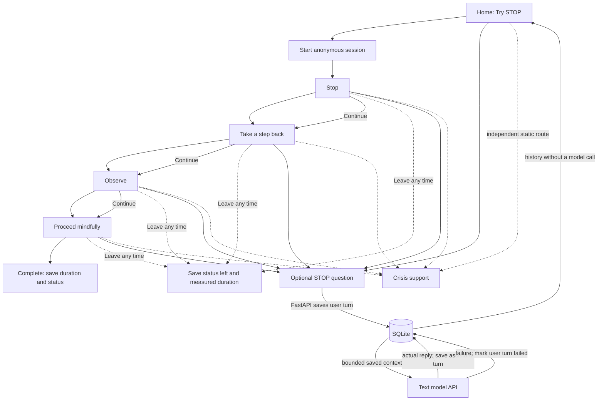

# Part 3.2 — Working vertical slice

## Scope

This increment implements one skill: STOP. It demonstrates the app boundary,
optional model explanation, local conversation/session persistence, an elapsed
duration, an independent crisis-support route, an explicit early exit, and a
sanitized model-failure state. It is a local coursework prototype for fictional
scenarios. It is not therapy, diagnosis, emergency support, or a monitored
service.

The live text provider call is optional and can be disabled. The current key is
read only by FastAPI from the ignored `backend/.env`; it is never sent to Vue.
The deterministic demo mode and forced-failure mode run without contacting a
provider. Voice/WebRTC is a separate earlier class increment and is not part of
the STOP text/session persistence path.

## Main experience

The actual experience has a sequential four-step Continue control. Users can
leave from any step and open crisis support at any time. It does not implement
skip or pause controls from the Part 3.1 proposal. The intended guided pace is
60 seconds plus up to four local transitions under one second each, without
model Q&A. The current interface exposes optional Q&A during practice; its
request and provider delay are included in the measured session duration and
can extend the session beyond that intended pace. Entry/setup is not measured
separately, and user-chosen pauses are not excluded because there is no explicit
pause control.

## Model role and data

The model is an optional explainer for the reviewed STOP skill. FastAPI selects
the model, prompt, and recent conversation context (at most eight most recent successful messages),
sets the provider request, validates the response, and handles errors. It does
not diagnose, judge distress, determine whether support appears, or operate
SQLite. The browser sends only a question and session identifier to the app API.

SQLite at `data/app.sqlite3` stores:

- `conversations`: opaque conversation identifier and creation timestamp.
- `skill_sessions`: linked conversation, STOP skill, current step, status, start
  and end timestamps, and measured duration in seconds.
- `messages`: linked conversation/session, role, content, request status, model
  source for actual assistant replies, and timestamp.

No user name, email, or account identifier is requested. A failed request keeps
the submitted user message marked `failed` and saves no assistant message. The
crisis information is static and available even when the model is not. Ordinary
history reads SQLite and makes no provider call. The database stays local and
is Git-ignored.

## R/D connections

The assignment summary describes an ongoing study with 15 patients, 13
clinicians, 15 prototype evaluation sessions, and 150 participant–task
combinations in the coded evaluation data. Its mention counts are evidence of
where themes appeared, not measures of clinical effectiveness.

| Finding | Design decision and current implementation |
| --- | --- |
| **R1 (38 mentions):** around 60 seconds was comfortable; attention loss/abandonment appeared after 90–100 seconds. | Part 3.1 proposes 60 seconds of guided steps and a bounded transition allowance, under 90 seconds total. The Part 3.2 interaction has no timeout or required response; it records actual duration, including step transitions and any optional in-exercise model request/response delay. Explicit pause accounting is not implemented, so user-chosen pauses are currently included. |
| **R2 (30 mentions):** crisis access should be frictionless across the journey. | A crisis-support control remains visible in the shared header and opens static information without model access. Localized links remain undecided. |
| **R3 (39 mentions; all 15 participants raised stop/leave):** leaving must carry no consequence. | The app offers Leave from any exercise step, asks for no reason, and stores status `left` with measured duration. |
| **R4 (68 mentions):** offer control over the journey rather than routing people to one path. | The person decides whether to start, ask the optional model, continue, leave, or open support. This version has one chosen skill only and does not infer emotional state. |
| **D1 (54 mentions):** contract the interface as distress rises, but the study gives no reliable detection method or specific contraction behavior. | The active exercise always removes the home overview and shows one step. The app does not detect distress. The safety control stays visible; a user-selected compact view is future work. |
| **D2 (100 mentions):** one atomic skill at a time. | One STOP skill, one step per exercise view. There is no library/menu inside practice. |
| **D3 (148 mentions; every participant):** reduce emotional cost of feeling, disclosing, or performing. | No disclosure, speech, feedback, or model response is needed to complete STOP. The question box is optional. Live-mode questions are sent to the configured provider; saved messages stay in local SQLite. |
| **D4 (31 mentions):** keep safety affordance persistently visible. | Crisis-support control stays in the shared header on all app views, including while a request fails. |
| **D5 (49 mentions):** personalize without a configuration burden; one participant asked for a “usual skill.” | No preference questionnaire is added. With only one skill, Part 3.2 has no skill recommendation. A future multi-skill design would use explicit past selection/self-report, show the basis, and allow a one-step override. The interface discloses that recent conversation context accompanies a live question; whether to offer a separate context opt-out remains open. |
| **D6 (97 mentions; every participant):** use low-stimulus, non-judgmental language. | Use restrained visual styling and plain wording, visible focus, responsive layout, and reduced-motion support. Wording needs further user review. |

## Endpoints and failure behavior

| Route | Purpose | Failure handling |
| --- | --- | --- |
| `POST /api/exercises` | Create conversation and in-progress STOP session | UI shows start error; no successful session is implied |
| `PATCH /api/exercises/{id}/step` | Save the next sequential step | UI retains the step and offers retry/leave |
| `POST /api/exercises/{id}/messages` | Persist user turn, request optional explanation, persist only a valid real reply | Sanitized error; user turn remains failed; no fabricated reply |
| `POST /api/exercises/{id}/finish` | Mark completed or left with end time and duration | UI reports if local database confirmation failed; page-exit beacon is a best-effort fallback |
| `GET /api/history` | Return recent sessions and messages from SQLite | History gets an unavailable notice; current exercise can continue |
| `GET /api/support` | Return static crisis-support wording | The visible support page is local/static and does not wait for model generation |

Live text calls use a finite timeout and the backend returns bounded, sanitized
failure detail. The app provides `MODEL_MODE=openai`, `MODEL_MODE=demo`, and
`MODEL_MODE=fail` for live, deterministic, and failure verification. Treat
provider handling according to the configured account’s terms; local storage
does not imply provider-side non-retention.

## Personalization, control, and open questions

The current version personalizes only through explicit session step progression
and optional question context. It does not infer a preference or emotional
state. The person chooses whether to ask the model, controls progression, can
leave, and can open the support route. No editable personalization controls
have been implemented yet.

Open decisions from the design proposal remain: finalized step wording and
pace; crisis-resource localization; message/session retention and deletion;
editable text-size, reduced-motion, and timing preferences; whether saved chat
context should be opt-in; optional self-report; privacy consent and hosting; and
whether/how to implement the proposed RAG workflow. See `docs/report.md` for
the complete questions. Part 3.2 is a small working slice, not completion of
those product decisions.
