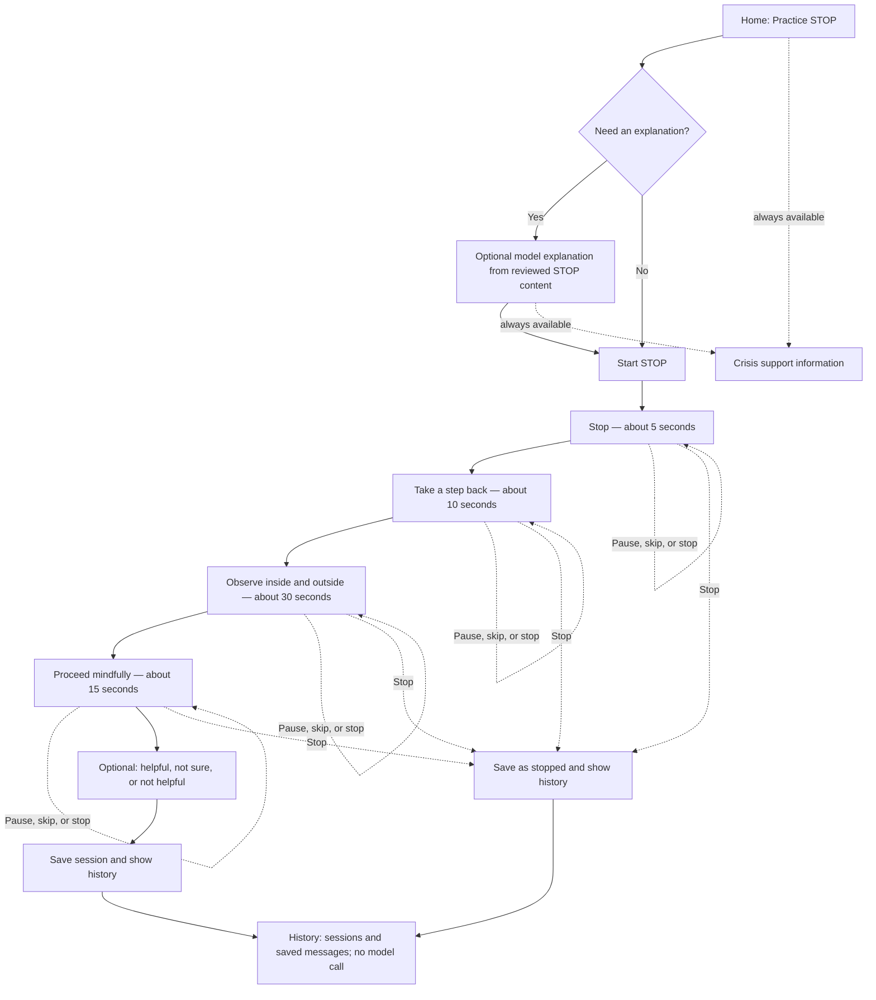

# Part 3.1 — Design proposal

## Scope and scenario

This proposal covers one skill: **STOP**. The fictional scenario is a person who
wants a brief pause after a stressful interaction. The prototype is for coursework
and fictional scenarios only; it is not therapy, diagnosis, crisis monitoring,
or a real mental health support service.

The guided sequence keeps the four skill steps in order: stop, take a step back,
observe what is happening internally and externally, and proceed mindfully. It
does not require typing or a model response. Entry and setup happen before the
timed sequence.

## Main experience

The exercise instructions are fixed, reviewed text. Each screen has one action
and a Continue control. Pause freezes the cue; Continue resumes it. Skip advances
to the next step while preserving the remaining order. Stop exits immediately
and records the session as stopped. A static progress indicator is the default;
motion is optional and can be disabled. A clearly labeled **Crisis support**
control stays visible on every screen and opens static information without
calling the model or checking for distress.

### Intended duration

| Step | Intended time |
| --- | ---: |
| Stop | 5 seconds |
| Take a step back | 10 seconds |
| Observe internally and externally | 30 seconds |
| Proceed mindfully | 15 seconds |
| **Guided sequence** | **60 seconds** |

The target is 60 seconds of step time, plus up to four local screen/control
transitions assumed to take under one second each: about 64 seconds total. There
are no required spoken or typed responses and no network requests inside the
sequence. Entry and any optional explanation happen before the first exercise
instruction and are reported separately. User-chosen pauses are not forced to
end; they are outside the intended pace. A person can stop at any point.

## Model role and boundaries

The model is optional and only used before or after the guided sequence when the
person asks a question. It may explain the app or paraphrase the reviewed STOP
description in plain language. It must not add therapeutic steps, change the
sequence, assess a person's mental state, diagnose, recommend treatment, or
decide whether crisis support should be shown. The exercise itself remains
available when the model is slow or unavailable; a failed request shows a brief
static explanation and the same controls.

For an optional answer, FastAPI supplies the reviewed STOP material and only
the same demo user's explicitly saved preferences or relevant prior messages.
Backend code selects and limits that context; the model has no direct database
access. Keep provider calls bounded, use finite timeouts, and label generated
answers as model responses. Ordinary history browsing does not call the model.

## Data to store and show

Use local SQLite through the Python backend. Do not create the database as part
of this design milestone.

| Record | Proposed fields | User-facing use |
| --- | --- | --- |
| Session | ID, demo-user ID, skill, start/end timestamps, duration, completed/stopped status | Session history with time and outcome |
| Message | ID, conversation ID, role, content, timestamp, request status | Reconstruct the actual conversation in order; failed requests have no fabricated reply |
| Conversation | ID, demo-user ID, created timestamp | Group related questions and answers |
| Preference | Demo-user ID, explicitly selected display/motion/pacing choices, updated timestamp | Apply choices the person can review and change |
| Optional feedback | Session ID, self-reported helpful/not sure/not helpful/skip value, timestamp | Show the person's own report; do not interpret it as a clinical measure |

Use a local demo identifier rather than collecting a name or email. Store actual
submitted messages and actual model replies when a model exchange occurs. Keep
self-report distinct from app events: a click, pause, skip, or stopped session
does not establish an emotion or diagnosis. The history view shows session
timestamps, duration, status, and messages in order. A person can inspect and
delete saved history; retention duration and deletion behavior still need a
product decision.

## Personalization and user control

Personalization is explicit and changeable. Offer optional choices for reduced
motion, text size, and whether to show timing cues. Do not ask for these choices
before the first exercise; use accessible defaults and make settings available
from the experience. The person can change a choice at any time. If more skills
are later added, they may explicitly choose a default skill or mark a skill as
helpful; the app should not infer preference from clicks, completion, or time
spent.

The person starts the skill, can skip a step, pause, stop, choose whether to
request model help, and decide whether to answer the optional feedback prompt.
The crisis-support route remains available independently of all those choices.

## Decisions connected to the supplied R/D findings

| Finding supplied in the assignment text | Design decision | Tradeoff |
| --- | --- | --- |
| **R1:** participants lost attention beyond 90–100 seconds; the assignment requires a guided skill of no more than 90 seconds. | Use four fixed STOP steps with a 60-second intended pace, no required typing, and no model call during the sequence. State the timing assumptions and keep entry/setup separate. | A short, fixed pace limits elaboration. Pause and stop remain available, so the app does not force a person to finish on the clock. |
| **D1:** the finding does not establish a reliable way to detect distress. | Do not infer distress from clicks, language, or a classifier. Let the person choose STOP. Keep crisis information visible and available without a model or classifier decision. | The app will not automatically recognize when someone needs support; it makes the route easy to find and leaves the choice with the person. |

The pasted assignment text refers to R2–R4 and D2–D6 but does not include their
labels or evidence. This proposal does not assign claims to those findings.
The study counts in the brief describe the evaluation sample; they are not
evidence of clinical effectiveness.

## Questions to resolve

- What exact, reviewed wording should be used for each STOP step and its timing?
- Which local crisis-support information and location should the static route use?
- What retention period and delete-history behavior should apply to messages and sessions?
- Should optional model help include prior message context by default, or only when the person asks to use history?
- What are the full R2–R4 and D2–D6 labels and evidence from the class research summary?
- Should timing cues default to the stated 5/10/30/15-second pace, or should the person choose their pace before starting?
