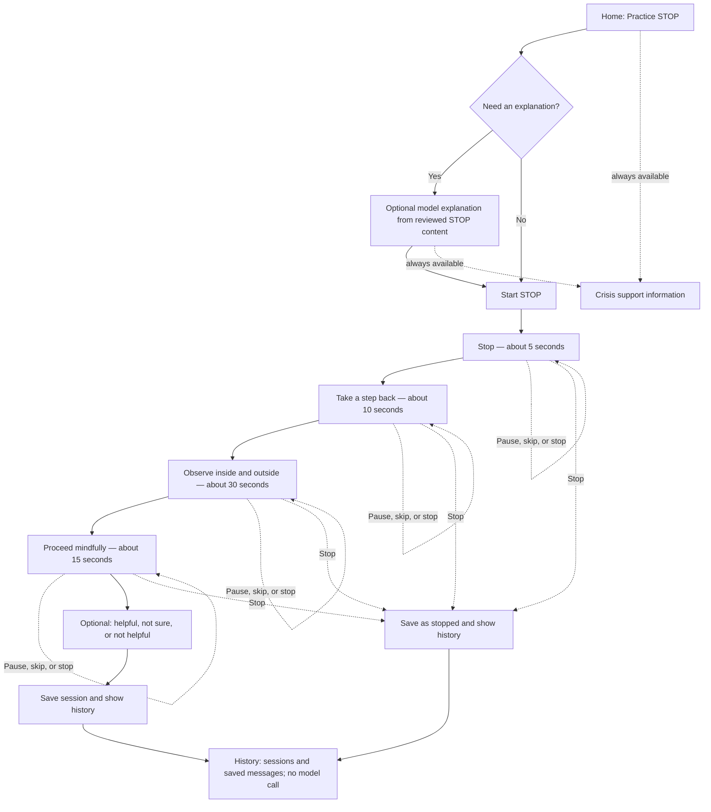

# Part 3.1 — Design proposal

## Scope and scenario

This proposal covers one skill: **STOP**. The fictional scenario is a person who
wants a brief pause after a stressful interaction. The prototype is for coursework
and fictional scenarios only; it is not therapy, diagnosis, crisis monitoring,
or a real mental health support service.

The guided sequence keeps the four skill steps in order: stop, take a step back,
observe what is happening internally and externally, and proceed mindfully. It
does not require typing or a model response. Entry and setup happen before the
timed sequence.

## Main experience

The exercise instructions are fixed, reviewed text. Each screen has one action
and a Continue control. Pause freezes the cue; Continue resumes it. Skip advances
to the next step while preserving the remaining order. Stop exits immediately
and records the session as stopped. A static progress indicator is the default;
motion is optional and can be disabled. A clearly labeled **Crisis support**
control stays visible on every screen and opens static information without
calling the model or checking for distress.

### Intended duration

| Step | Intended time |
| --- | ---: |
| Stop | 5 seconds |
| Take a step back | 10 seconds |
| Observe internally and externally | 30 seconds |
| Proceed mindfully | 15 seconds |
| **Guided sequence** | **60 seconds** |

The target is 60 seconds of step time, plus up to four local screen/control
transitions assumed to take under one second each: about 64 seconds total. The
Part 3.1 proposal keeps model explanation before or after this timed sequence.
Part 3.2 has an optional Q&A panel during practice, so any question and provider
wait are included in the actual measured session and may extend it beyond the
intended guided pace. Entry/setup is not separately measured in Part 3.2. The
current app has no explicit Pause control, so it does not exclude user-chosen
pauses from the measured duration. It never forces someone to finish or leave.

## Model role and boundaries

The model is optional and answers a STOP question only when the person asks. It
may explain the app or paraphrase the reviewed STOP description in plain
language. It must not add therapeutic steps, change the sequence, assess a
person's mental state, diagnose, recommend treatment, or decide whether crisis
support should be shown. The fixed steps remain available when the model is
slow or unavailable; a failed request is visibly marked and does not invent a
reply.

The Part 3.1 proposal places optional model help before or after the timed
sequence. Part 3.2 instead displays an optional Q&A panel during practice. In
live mode, FastAPI sends the current question and up to eight most recent
successful messages from that session to the configured model. The interface
discloses that recent conversation accompanies a live question. The app does
not save preferences or provide the model direct database access. Ordinary
history browsing does not call the model. The Part 3.2 measured duration
includes any model call and its delay; this can extend the total beyond the
intended guided pace, and should be resolved in a later design iteration.

## Data to store and show

Use local SQLite through the Python backend. Do not create the database as part
of this design milestone.

| Record | Proposed fields | User-facing use |
| --- | --- | --- |
| Session | ID, anonymous local session/conversation ID, skill, start/end timestamps, duration, completed/left status | Session history with time and outcome |
| Message | ID, conversation ID, role, content, timestamp, request status | Reconstruct the actual conversation in order; failed requests have no fabricated reply |
| Conversation | ID, demo-user ID, created timestamp | Group related questions and answers |
| Preference | Demo-user ID, explicitly selected display/motion/pacing choices, updated timestamp | Apply choices the person can review and change |
| Optional feedback | Session ID, self-reported helpful/not sure/not helpful/skip value, timestamp | Show the person's own report; do not interpret it as a clinical measure |

Use a local demo identifier rather than collecting a name or email. Store actual
submitted messages and actual model replies when a model exchange occurs. Keep
self-report distinct from app events: a click, pause, skip, or stopped session
does not establish an emotion or diagnosis. The history view shows session
timestamps, duration, status, and messages in order. A person can inspect and
delete saved history; retention duration and deletion behavior still need a
product decision.

## Personalization and user control

Do not make a person complete a setup questionnaire. With multiple skills, use
the last skill they explicitly selected or marked helpful as a suggested default
and make the reason visible; provide an immediate way to choose a different
skill. Do not treat opens, completions, time spent, or language as evidence of
emotional state. For interface preferences, honor platform accessibility
settings such as reduced motion by default and keep optional display/timing
controls easy to find and change without blocking the first exercise.

The person chooses whether to start, ask the model, continue, leave, or open
crisis support. A future optional helpful/not-sure/not-helpful response can
inform the person's own suggested default, but it is self-report, not a measure
of clinical status. Part 3.2 currently has only one skill, no preference
settings, and no feedback question; those are explicit limits of the vertical
slice.

## Decisions connected to the supplied R/D findings

The assignment research summary describes an ongoing study involving 15 patients,
13 clinicians, and 15 prototype evaluation sessions, with 150 participant–task
combinations in the coded evaluation data. The mentions below show where themes
appeared in participant feedback and behavior; they are not measures of clinical
effectiveness.

| Finding and evidence | Design decision | Tradeoff and Part 3.2 status |
| --- | --- | --- |
| **R1 — Keep skills short:** 38 mentions; comfortable around 60 seconds, with attention loss and abandonment reported beyond 90–100 seconds. | Aim for 60 seconds of guided steps (5/10/30/15 seconds), plus at most four local transitions assumed under one second each. Do not require a model answer or typed response inside the skill. State entry/setup separately and never force completion on a timer. | The app does not force completion. Part 3.2 does not impose the proposed pace; its measured duration includes optional in-exercise model requests and user-chosen pauses, which are not separately recorded. |
| **R2 — Frictionless crisis access:** 30 mentions across all 15 participants, concentrated on crisis access and overall journey tasks. | Keep a plainly labeled crisis-support control visible throughout every app view and serve static information without waiting for a model. | Generic static information is available quickly, but local/regional resource links still need to be selected and reviewed. Part 3.2 implements the always-visible control and model-independent route. |
| **R3 — Permission to stop:** 39 mentions; all 15 participants raised stop/leave on that task. | Provide Leave on every exercise step, explain that leaving is allowed, record a `left` status, and do not require a reason. | Leaving ends the saved session rather than offering resume. Part 3.2 implements explicit Leave and records the outcome and duration. |
| **R4 — User controls the journey:** 68 mentions, strongest on permission-to-stop, overall journey, and choosing by emotional state. | Offer meaningful choices without inferring a state: start STOP, ask for optional explanation, continue, leave, or open support. If more skills are added, let the person select/change a skill instead of routing based on a guessed emotion. | The current vertical slice offers only STOP, so it is not yet a multi-skill chooser. It does not classify language or infer emotional state. |
| **D1 — Progressive interface contraction:** 54 mentions, strongest on crisis access and overall journey. The study did not identify a reliable way to detect rising distress or specify what should contract. | Keep the home overview out of the active practice view and show one step at a time for every user. Do not use a distress detector to change the interface. Keep safety access outside the contraction. | This predictable reduction avoids a risky inference but cannot adapt contraction to a person’s momentary need. A user-selectable compact view remains a design option, not an implemented feature. |
| **D2 — One atomic skill at a time:** 100 mentions across all participants, on STOP, cognitive reframe, and paced breathing. | Build one chosen skill as a four-step sequence with one step per active screen; avoid a skill library or dashboard during practice. | The current version supports only STOP and sequential Continue. Pause/skip controls from the proposal have not yet been implemented. |
| **D3 — Minimize emotional cost:** 148 mentions, present for every participant, concentrated on breathing and grounding. | Do not require disclosure, reflection, speech, or model interaction to complete the steps. Make model help optional and keep prompts neutral. | A person can complete STOP without sending personal text. If they choose to ask a question, the message is stored locally and in live mode sent to the configured provider; the UI states this. |
| **D4 — Persistently visible safety:** 31 mentions, almost entirely on crisis access and overall journey. | Keep the crisis-support button in the shared header on home, exercise, completion, and support views. | This uses screen space, but keeps the route findable. Part 3.2 implements the persistent button. |
| **D5 — Personalization without configuration burden:** 49 mentions, strongest on lightweight feedback and choosing by emotional state; one participant described a “usual skill.” | In a future multi-skill version, make the last explicitly chosen or self-rated helpful skill an editable default. Avoid a setup questionnaire, explain why it is suggested, and allow an immediate alternative. Do not infer emotional state from completion, clicks, or time. | There is only one skill in Part 3.2, so no recommendation is needed or implemented. Saved conversation context is used only when the person asks the model a question, but the question panel now discloses that recent conversation context accompanies a live question; a separate opt-out is still an open decision. |
| **D6 — Low-stimulus, non-judgmental language:** 97 mentions across all participants, especially cognitive reframe and overall journey. | Use plain, non-clinical, non-cheerleading language, restrained color and motion, readable contrast, keyboard focus, and a narrow-screen layout. | Neutral language can feel less expressive; it avoids labeling or minimizing a person’s experience. Review wording with users before expanding the skill set. |

## Questions to resolve

- Which exact, reviewed STOP wording and pacing should be used in the next iteration, and should explicit pause time be excluded from stored active duration?
- Which vetted crisis-support links and region choices should the static route show?
- What retention period and delete-history behavior should apply to sessions and messages?
- Should prior messages be sent as model context by default, or only after a separate user choice?
- How should a later multi-skill version define “usual skill” from explicit choice or self-report while making recommendations visible and easy to change?
- Should text size, reduced motion, timing cues, or other personalization remain adjustable without a setup questionnaire?
- What optional self-report, if any, would help the person without adding emotional or configuration burden?
- Which parts of the proposed RAG workflow are necessary for reviewed skill content, and how will retrieved sources be shown?
